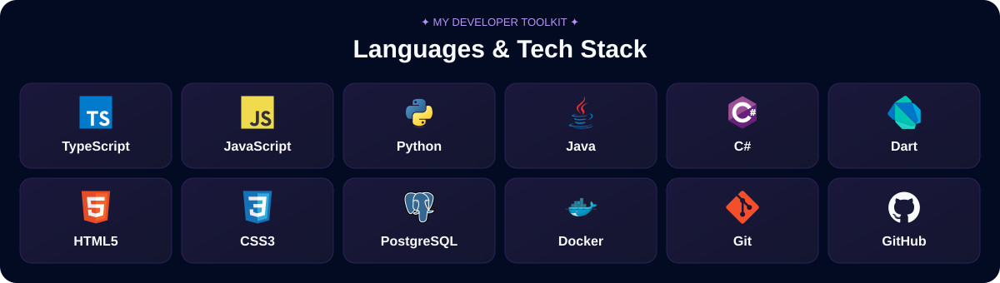
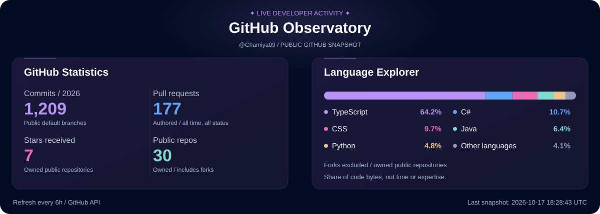

<!-- observatory:start -->

<picture>
  <source media="(max-width: 600px)" srcset="assets/github-observatory-mobile.svg" />
  
</picture>

<!-- observatory-data: {"include_forks": false, "language_bytes": {"C": 1488, "C#": 996312, "C++": 25203, "CMake": 19764, "CSS": 903408, "Dart": 5876, "Dockerfile": 3286, "HTML": 7985, "Java": 597128, "JavaScript": 275858, "Kotlin": 134, "Objective\u002dC": 38, "PLpgSQL": 3562, "PowerShell": 3208, "Python": 446413, "Shell": 34833, "Swift": 2036, "TypeScript": 5961158}, "metrics": {"commits": 1211, "public_repositories": 30, "pull_requests": 177, "stars": 7}, "queries": {"commits": "author:Chamiya09 author\u002ddate:2026\u002d01\u002d01..2026\u002d10\u002d17 is:public", "pull_requests": "is:pr author:Chamiya09 is:public"}, "repositories": [{"fork": false, "language_bytes": {"C#": 16465, "CSS": 5894, "HTML": 372, "JavaScript": 6114}, "repository": "Chamiya09/CampusEats", "stars": 0}, {"fork": false, "language_bytes": {"JavaScript": 52}, "repository": "Chamiya09/campuseats\u002dtask\u002dtracker", "stars": 0}, {"fork": false, "language_bytes": {"Python": 24734}, "repository": "Chamiya09/Chamiya09", "stars": 0}, {"fork": false, "language_bytes": {}, "repository": "Chamiya09/CourseWeb\u002dAssistant", "stars": 0}, {"fork": false, "language_bytes": {}, "repository": "Chamiya09/CourseWeb\u002dAssistant\u002dExtension", "stars": 0}, {"fork": false, "language_bytes": {"Java": 353438, "PLpgSQL": 3562}, "repository": "Chamiya09/Dissanayake\u002dSuper\u002dWeb\u002dPOS\u002dBackEnd", "stars": 1}, {"fork": false, "language_bytes": {"CSS": 7660, "HTML": 1255, "JavaScript": 21482, "TypeScript": 1108442}, "repository": "Chamiya09/Dissanayake\u002dSuper\u002dWeb\u002dPOS\u002dFrontEnd", "stars": 1}, {"fork": false, "language_bytes": {"Python": 58442}, "repository": "Chamiya09/Dissanayake\u002dSuper\u002dWeb\u002dPOS\u002dML\u002dEngine", "stars": 1}, {"fork": false, "language_bytes": {"Java": 243690}, "repository": "Chamiya09/DriveNow\u002dVehicle\u002dRental\u002dService\u002dBackend", "stars": 0}, {"fork": false, "language_bytes": {"CSS": 12876, "HTML": 1107, "JavaScript": 846, "TypeScript": 1099694}, "repository": "Chamiya09/DriveNow\u002dVehicle\u002dRental\u002dService\u002dFrontend", "stars": 0}, {"fork": false, "language_bytes": {}, "repository": "Chamiya09/intro\u002dto\u002dgithub", "stars": 0}, {"fork": true, "language_bytes": null, "repository": "Chamiya09/IT3012\u002d\u002d\u002dPractical\u002dBase", "stars": 0}, {"fork": false, "language_bytes": {"Python": 245226}, "repository": "Chamiya09/IT3012\u002dPacMan\u002dSearch\u002dGroup07", "stars": 0}, {"fork": false, "language_bytes": {}, "repository": "Chamiya09/Mototrade", "stars": 0}, {"fork": false, "language_bytes": {"JavaScript": 3845, "TypeScript": 426617}, "repository": "Chamiya09/NexGO\u002dAdmin\u002dApp", "stars": 1}, {"fork": false, "language_bytes": {"JavaScript": 213142}, "repository": "Chamiya09/NexGO\u002dBackEnd", "stars": 1}, {"fork": false, "language_bytes": {"JavaScript": 3902, "TypeScript": 452998}, "repository": "Chamiya09/NexGO\u002dDriver\u002dApp", "stars": 1}, {"fork": false, "language_bytes": {"JavaScript": 4468, "TypeScript": 614542}, "repository": "Chamiya09/NexGO\u002dPassenger\u002dApp", "stars": 1}, {"fork": false, "language_bytes": {}, "repository": "Chamiya09/RouteLK\u002dBackEnd", "stars": 0}, {"fork": false, "language_bytes": {"CSS": 5060, "HTML": 370, "JavaScript": 591, "TypeScript": 4037}, "repository": "Chamiya09/RouteLK\u002dFrontEnd", "stars": 0}, {"fork": false, "language_bytes": {"Dockerfile": 1579, "Python": 118011, "Shell": 10958}, "repository": "Chamiya09/Skill\u002dHub\u002dAI\u002dAgent", "stars": 0}, {"fork": false, "language_bytes": {"C#": 979847, "Dockerfile": 1707, "PowerShell": 3208, "Shell": 7568}, "repository": "Chamiya09/Skill\u002dHub\u002dBackEnd", "stars": 0}, {"fork": false, "language_bytes": {"CSS": 867629, "HTML": 1238, "JavaScript": 603, "Shell": 6061, "TypeScript": 2254828}, "repository": "Chamiya09/Skill\u002dHub\u002dFrontEnd", "stars": 0}, {"fork": false, "language_bytes": {"C": 1488, "C++": 25203, "CMake": 19764, "Dart": 5876, "HTML": 1545, "Kotlin": 134, "Objective\u002dC": 38, "Swift": 2036}, "repository": "Chamiya09/Skill\u002dHub\u002dMobile\u002dApp", "stars": 0}, {"fork": false, "language_bytes": {"CSS": 2537, "HTML": 1800, "JavaScript": 9897, "Shell": 10246}, "repository": "Chamiya09/skills\u002dintroduction\u002dto\u002dgit", "stars": 0}, {"fork": false, "language_bytes": {}, "repository": "Chamiya09/skills\u002dintroduction\u002dto\u002dgithub", "stars": 0}, {"fork": false, "language_bytes": {}, "repository": "Chamiya09/SnapOut", "stars": 0}, {"fork": false, "language_bytes": {}, "repository": "Chamiya09/SnapOut\u002dCapture", "stars": 0}, {"fork": false, "language_bytes": {"JavaScript": 3619}, "repository": "Chamiya09/WMT\u002dLab\u002dTest\u002dBackend", "stars": 0}, {"fork": false, "language_bytes": {"CSS": 1752, "HTML": 298, "JavaScript": 7297}, "repository": "Chamiya09/WMT\u002dLab\u002dTest\u002dFrontend", "stars": 0}], "schema_version": 1, "through_date_utc": "2026\u002d10\u002d17", "updated_at": "2026\u002d10\u002d17T18:37:40Z", "username": "Chamiya09", "year": 2026} -->

<!-- observatory:end -->
